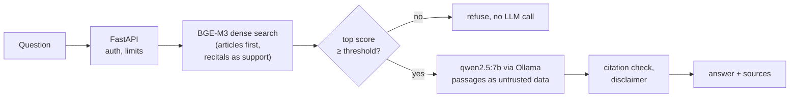

# EuroLex-RAG

<!-- TODO: replace OWNER/REPO once the repository is on GitHub -->
[](https://github.com/OWNER/REPO/actions/workflows/ci.yml)

A self-hosted assistant that answers questions about the GDPR from the official EU text, cites
the articles it used, and says "I don't know" when the evidence is weak. Every design choice
is backed by a measured, reproducible evaluation.

> **Not legal advice.** EuroLex-RAG gives general information about EU law. Check the cited
> articles and ask a lawyer about your own situation.

<!-- TODO (human): add a demo GIF (SPEC.md section 10, task 5) -->

## Problem and motivation

The GDPR is 99 articles and 173 recitals of dense legal text. People with a simple question
("how long does a company have to answer my access request?") either read the regulation or
ask a general chatbot, which may answer fluently without saying where the answer comes from.

This project answers from the official text only, shows the exact passages it relied on, and
refuses when retrieval does not find good evidence. It runs entirely on a laptop: no data
leaves the machine.

The main deliverable is not the chat UI but the evaluation: how much each retrieval idea
(chunking, hybrid search, reranking, query rewriting) actually changes the results, measured
on a fixed, reviewed question set.

## How this differs

- **English, official text.** Built from the official English GDPR published by the EU
  Publications Office.
- **Open and self-hosted.** Open models (BGE-M3, qwen2.5 via Ollama), Qdrant, no paid APIs.
- **Measured.** Every change is an experiment config with saved runs, git commit and seed;
  `docs/results.md` is generated from them, never typed by hand.
- **Published evaluation method.** The question set, its review log and the dev/test split
  are in the repo, with the limits stated below.

## Architecture



Offline, `make ingest` downloads the GDPR, parses articles and recitals, cuts article-aware
chunks, embeds them with BGE-M3 and indexes them in Qdrant. Online, the API embeds the
question, retrieves articles (with the three best recitals as extra context), refuses if the
best match is below a threshold chosen on dev data, and otherwise asks the LLM to answer
only from the numbered passages. Citations to passages that were not given are removed.
More in [docs/architecture.md](docs/architecture.md).

## Results

Question set: 97 validated questions (75 dev, 22 test), of which 24 are out of scope.
22 are based on real public FAQ topics (`source: faq`); the other 75 were drafted by an LLM
and reviewed by hand. 39 of 114 LLM candidates (34%) were rejected in review. Full tables,
per question type, in [docs/results.md](docs/results.md).

**Retrieval, dev split** (60 in-scope questions, used for tuning):

| Experiment | What changed | R@1 | R@5 | nDCG@10 | p50 latency |
|---|---|---|---|---|---|
| E0 | fixed-size chunks, dense | 0.233 | 0.444 | 0.399 | 0.3 s |
| E1 | article-aware chunks, dense | 0.422 | 0.811 | 0.669 | 0.3 s |
| E2 | BM25 only | 0.189 | 0.386 | 0.320 | 0.0 s |
| E3 | dense + sparse hybrid (RRF) | 0.439 | 0.747 | 0.653 | 0.3 s |
| E4 | E3 + reranker | 0.425 | 0.819 | 0.685 | 14.5 s |
| E5 | E4 + query rewriting | 0.417 | 0.828 | 0.691 | 18.0 s |
| **E1s** | **E1, articles ranked alone, recitals as support** | **0.711** | **0.894** | **0.856** | **0.3 s** |
| E4s | E4 with articles first | 0.725 | 0.864 | 0.847 | 15.4 s |
| E6 | embedding comparison | TODO | TODO | TODO | TODO |

**Final pipeline, test split** (run once, nothing tuned on it; 13 in scope, 9 out of scope):

| | Test | Dev |
|---|---|---|
| nDCG@10 | 0.793 | 0.856 |
| R@1 / R@10 | 0.577 / 0.923 | 0.711 / 0.961 |
| Out-of-scope questions refused | 9/9 | 15/15 |
| In-scope questions refused | 0/13 | 2/60 |
| Answers citing a gold article | 77% | 83% |

**Human check of 20 dev answers:** 15 correct, 5 partly correct, 0 wrong. In 12 of 20 every
cited passage supported its claim; 8 cited at least one wrong or irrelevant passage. The LLM
judge (mistral) gave all 20 a 5/5, so judge scores are not used as evidence of faithfulness.
See [docs/error-analysis.md](docs/error-analysis.md) for ten real failure cases.

## Quickstart

Needs Python 3.11+, [uv](https://docs.astral.sh/uv/), Docker, GNU make and
[Ollama](https://ollama.com). On Windows use `gmake` (e.g. from Strawberry Perl or Git for
Windows). A GPU helps for ingestion and evaluation but is not required.

```bash
git clone https://github.com/OWNER/REPO.git && cd REPO
make setup                       # install locked dependencies and pre-commit hooks
cp .env.example .env             # then set API_KEY, see below
uv run python -c "import secrets; print(secrets.token_urlsafe(32))"
ollama pull qwen2.5:7b-instruct
make qdrant                      # start Qdrant
make ingest                      # download, parse, chunk, embed, index the GDPR
make up                          # start Qdrant, the API and the UI in Docker
```

The first `make up` builds the image (about 3.6 GB) and the API downloads BGE-M3 (2.3 GB)
before it answers; on a slow connection that takes a while, and Docker may show the API as
"unhealthy" until it is done. Then open http://localhost:8501, or ask the API directly:

```bash
# replace YOUR_KEY with the API_KEY from .env
curl -s http://localhost:8000/ask -H "X-API-Key: YOUR_KEY" -H "Content-Type: application/json" \
  -d '{"question": "How long does a company have to answer my access request?"}'
```

API docs: http://localhost:8000/docs. To run without Docker: `make qdrant`, then `make api`
and `make ui` in two terminals.

## Reproduce the evaluation

```bash
make qdrant && make ingest
make eval CONFIG=configs/e1s_articles_first.yaml SPLIT=dev
make eval CONFIG=configs/e7_threshold.yaml SPLIT=dev     # needs qwen2.5 and mistral in Ollama
make report                                              # rebuilds docs/results.md
```

Each run writes `runs/<run_id>/summary.json` with the config, git commit, seed, device and
question-set hash. A run is marked not reportable if the tree was dirty, pending questions or
`--limit` were used, a query rewrite failed, or a prompt filled the model's context window.
The test split is for final numbers only.

## Design decisions and what failed

Each decision has an ADR in [docs/adr/](docs/adr/). The main ones:

- **Article-aware chunks** beat fixed-size chunks by a wide margin (E0 0.399 → E1 0.669).
- **Hybrid search, the reranker and query rewriting did not clearly pay off here.** E3–E5
  scored 0.653–0.691 against E1's 0.669 on dev, and the reranker made queries about 50× slower on a 4 GB laptop
  GPU (ADR 006).
- **What did work: rank articles alone and add recitals as support** (E1s, 0.856). Recitals
  were taking top spots from the articles that are the gold answers (ADR 008).
- **Evidence threshold** on the top dense score, picked on dev (0.5003). It cleanly split
  dev, but the margin was small, and on test it caught 6 of 9 out-of-scope questions; the
  model refused the other 3 (ADR 009).
- **Prompt injection:** passages are delimited as data and brackets are neutralised. Against
  the real model, an instruction inside a passage to *end* the answer with a word was
  defeated by post-processing; one to *begin* the answer with a word still gets through
  (kept as a known failing test, ADR 009).
- **LLM judge:** mistral scored every answer 5/5, including ones a human found unsupported.
- **Ollama's default context window** (4096 tokens) would have silently cut 4 of 75 dev
  prompts; runs now use 8192 and record the token count of every prompt.

## Security and privacy

- Secrets only in `.env` (gitignored); `.env.example` lists every variable.
- `POST /ask` needs `X-API-Key` (401 otherwise), questions are limited to 500 characters
  (422), and there is a per-client rate limit (429).
- Retrieved text is treated as untrusted data in the prompt; model output is HTML-escaped in
  the UI.
- Questions are not stored: the API has no answer cache, the UI keeps the chat only in the
  browser session, and logs carry a hash and a length instead of the text unless
  `LOG_QUERIES=true` is set for local debugging. A hash of a short, common question can be
  guessed, so the logs are pseudonymous, not anonymous.
- **GDPR note:** users may type personal data into a question. With the defaults it is
  processed in memory to answer and not kept. If you enable `LOG_QUERIES` or Langfuse tracing
  with `LOG_QUERIES=true`, you store it and become responsible for it.
- Pinned dependencies (`uv.lock`), Dependabot, CI on every push.

## Limitations

- GDPR only; the AI Act is planned (ADR 004).
- Small question set: 60 in-scope dev and 13 in-scope test questions, so one question moves
  test recall by about 8 points. Most questions were drafted by an LLM, then reviewed.
- Annotators: TODO (fill in).
- Short, casual questions ("what is gdpr") can fall below the threshold and be refused; the
  dev set has few such questions.
- Answers can cite an irrelevant passage next to a correct one, or leave out exceptions.
- On a 4 GB GPU an answer takes about 50 s (p50 generation time on dev), and the API answers
  one question at a time.
- Information, not legal advice.

## License

[MIT](LICENSE)
