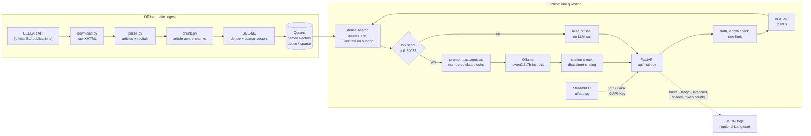

# Architecture

## Overview

## Pieces

| Piece | Where | Notes |
|---|---|---|
| Download | `ingestion/download.py` | CELLAR, because EUR-Lex blocks scripts with a bot check (ADR 002) |
| Parse and chunk | `ingestion/parse.py`, `chunk.py` | one chunk per article, split by paragraph when long (ADR 003) |
| Embed and index | `embeddings.py`, `ingestion/index.py` | BGE-M3 at a pinned revision; idempotent upserts (ADR 005) |
| Retrieval | `retrieval/pipeline.py` | dense, sparse, BM25, RRF, reranker and rewriting are all config options (ADR 006); the served config ranks articles only and adds recitals as support (ADR 008) |
| Generation | `generation/` | prompt with passages as untrusted data, `[n]` citations checked, evidence threshold (ADR 009) |
| Evaluation | `evaluation/` | runner, metrics, report, LLM judge, question review tools (ADR 007) |
| API | `api/` | the evaluated `e7_threshold` config; key auth, limits, JSON logs (ADR 010) |
| UI | `ui/` | Streamlit, talks to the API only |

## Running it

- `make up` starts Qdrant, the API and the UI in Docker. Ollama runs on the host (better GPU
  support on Windows and macOS); the containers reach it at `host.docker.internal:11434`.
  To run Ollama in Docker instead: `docker compose --profile ollama up -d ollama` and set
  `DOCKER_OLLAMA_URL=http://ollama:11434` in `.env`.
- Ingestion and evaluation run on the host (`make ingest`, `make eval`), so they can use a
  local GPU. The containers are CPU-only.

## Why these boundaries

- The API serves exactly one evaluated config, so the UI behaves like `docs/results.md` says.
- The UI never imports the pipeline. It could be replaced by any HTTP client.
- Questions are never written to disk by the API: no answer cache, and logs carry only a
  hash and a length unless `LOG_QUERIES=true`.
